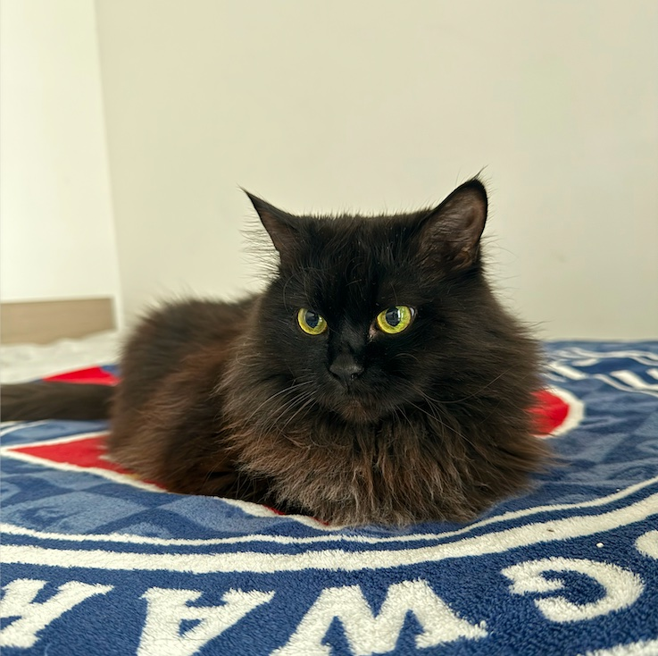

# Varia

### Analysis: key points as of 19.10.2026

*Data: 13.04.2026 – 19.10.2026*

*Updated: 20.10.2026*

## Main conclusions

What the records do and do not support. Numbers are in [“Lab trends”](labs-en.html), details in the [full chronology](chronology-en.html).

| Topic | What the data show | Conclusion |
| --- | --- | --- |
| **Prognosis and plan** | On 19.10 the oncologist (dr Drewniak) reported progression and a poor prognosis, advised against a tap and recommended considering euthanasia at this stage. By the owners’ decision — a 90 ml tap and **carboplatin 200 mg/m²**; medications unchanged | The attending vet considers the disease progressive. Any effect of carboplatin is expected after weeks at the earliest, while the fluid builds up within days |
| **Chest effusion** | No taps from July to September. From 26.09 to 19.10 — six: 128, 50, 100, 120, ~140 and 90 ml, 2–9 days apart; the last one three days after the previous. Breathing worsened before each | The fluid builds up fast and the intervals are getting shorter. Volumes and intervals are a reliable measure; ultrasound centimetres from different vets are not comparable |
| **Breathing at home** | Before each deterioration the home counts were 34–40 (17–24.09), 46 (04.10) and 44–46 (16.10); on 17.10, after furosemide and Palladia, — 26–28 while awake. On 19.10 at the visit — diaphragmatic, laboured | Home counting is the best early signal. Threshold for an urgent visit — 40/min or more |
| **Furosemide and kidneys** | 07.10 — creatinine 250. 16.10 — creatinine 156 (normal), but **urea 23.7 — the highest on record**. On 19.10 the vet allows 1 tablet twice daily if breathing is bad; no biochemistry on 19.10 | Creatinine recovered, urea did not. Tumour-related effusion usually responds poorly to diuretics: the calmest period (July–September) was without furosemide. Carboplatin is excreted by the kidneys |
| **Blood** | Haemoglobin 121 → 98 → 100 g/l (07.10 → 16.10 → 19.10); platelets 840 → 673; **neutrophils 17.38 and white cells 19.25 (19.10) — higher than on 07.10** | No neutropenia — this is the baseline before carboplatin. In June carboplatin together with Palladia led to severe neutropenia (Neu 0.45) |
| **Palladia** | No neutropenia on 07.10, 10.10, 16.10 or 19.10. The 16.10 dose was missed, given on 17.10; 19.10 — “medications unchanged” | In the owners’ observation it was the only treatment that worked; in the records the fluid builds up just as fast. Now apparently combined with carboplatin |
| **Signs of progression** | 26.09 — growth in the chest ~1 × 1.5 cm; 05.10 — 0.78 × 0.65 cm liver lesion (“possible metastasis”), right lung collapse; 19.10 — the oncologist explicitly records progression | Progression is stated by the attending vet; nothing has been confirmed cytologically or histologically |
| **Weight, feeding, GI** | 4.78 → 4.19 → **3.90 kg** (14.09 → 05.10 → 12.10), −25% since July; 19.10 — “has lost weight again” (no new value recorded). 16.10 — nausea and constipation; 19.10 per the owners — eating and drinking on her own since the sutures came out, no vomiting | Weight loss continues |
| **Eyes** | Sutures removed on 15.10: corneas clearer, no discomfort, visual responses preserved | The 25.09 surgery worked; the eye-drop schedule was simplified |

## Questions for the vet

1. **Goal of treatment:** how to judge whether carboplatin is helping and how Varia is feeling; when the next check is; what to do if breathing suddenly worsens, including at night.
2. **Blood and kidneys after carboplatin:** when to check neutrophils (in June, on carboplatin with Palladia, — Neu 0.45) and urea and creatinine (16.10 — urea 23.7; no biochemistry on 19.10). Whether to continue Palladia alongside carboplatin.
3. **Taps:** six in three and a half weeks, the last three days after the previous one. At what breathing and where to tap; whether an indwelling drain is needed.
4. **Furosemide and steroid:** on 19.10 an increase to 1 tablet twice daily and 1 tablet once daily was allowed — at what breathing to increase, and how this fits with urea of 23.7.
5. **Neutrophils 17.38 and white cells 19.25:** what is causing them and whether anything should be done.
6. **Feeding:** weight keeps falling — what to give long-term for nausea and constipation, whether an appetite stimulant is needed.

### About this part

The analysis was compiled by the owner from the same records as the full chronology and contains no data that are not there. A detailed review from 16.09–28.09.2026 is kept in the repository history.

**This document does not replace examination and assessment by a veterinarian.**
